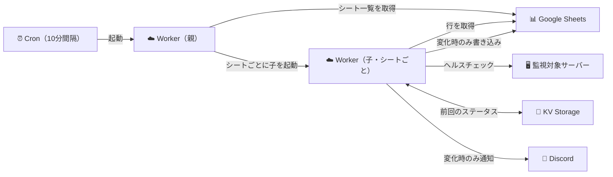

# SmartWatchdog 🐕

[](https://github.com/ROZ-MOFUMOFU-ME/smartwatchdog/actions/workflows/lint-format.yml)
[](https://github.com/ROZ-MOFUMOFU-ME/smartwatchdog/actions/workflows/deploy.yml)
[](./coverage/lcov-report/index.html)
[](https://www.typescriptlang.org/)
[](https://nodejs.org/)
[](https://workers.cloudflare.com/)
[](https://opensource.org/licenses/MIT)

> **Googleスプレッドシート**と**Cloudflare Workers**を使用したサーバーレスなサーバー死活監視ツール

## 📋 目次

- [概要](#概要)
- [主な機能](#主な機能)
- [アーキテクチャ](#アーキテクチャ)
- [技術スタック](#技術スタック)
- [セットアップ](#セットアップ)
- [使用方法](#使用方法)
- [開発](#開発)
- [テスト](#テスト)
- [CI/CD](#cicd)
- [トラブルシューティング](#トラブルシューティング)
- [貢献](#貢献)
- [ライセンス](#ライセンス)

## 🎯 概要

SmartWatchdogは、Googleスプレッドシートを管理画面として使用し、Cloudflare Workersでサーバーの死活監視を行うサーバーレスな監視ツールです。通知はDiscord Webhookで行います。Cloudflare Workersの無料プランの範囲で動くように作られています。

### ✅ 動作確認済み

- **Google Sheets API連携**: サービスアカウント認証による安全なアクセス
- **KVストレージ**: 前回のステータスを保存し、状態変化を検出
- **Discord通知**: エラー/復旧時の自動通知
- **Cronトリガー**: 10分間隔での自動監視
- **複数シート対応**: シート（タブ）ごとにサーバーグループを独立管理

### 🚀 本番運用例

- **監視URL**: `https://your-worker.your-subdomain.workers.dev`
- **実行間隔**: 10分間隔（Cronトリガー）
- **監視対象**: Googleスプレッドシート
- **通知先**: Discord Webhook

### 特徴

- **🔄 自動監視**: 設定した間隔でサーバーの状態を自動チェック
- **📊 スプレッドシート管理**: 直感的なGoogleスプレッドシートでの監視対象管理
- **🔔 Discord通知**: 状態変化をリアルタイムでDiscordに通知
- **🎨 視覚的フィードバック**: スプレッドシートの色分けで状態を一目で確認
- **💾 状態保持**: KVに前回のステータスを保存し、変化があったときだけ更新
- **🚀 サーバーレス**: Cloudflare Workersで動作し、サーバーの管理が不要

## ✨ 主な機能

### 1. サーバー監視

- HTTP/HTTPSエンドポイントの死活監視（ステータス200で正常）
- TCPポート監視（Cloudflare Sockets API）
- タイムアウト: HTTP 10秒 / TCP 15秒
- エラー内容（HTTPステータス、タイムアウト、到達不能など）をステータスとして記録

### 2. スプレッドシート連携

- 複数シート（タブ）対応
- 状態が変化した行だけ、ステータスと最終更新日時を書き込み
- エラーの行はステータス列の背景を赤く表示

### 3. Discord通知

- エラー発生時の通知
- 復旧時の通知
- エラー時のロールメンション（設定時）
- 埋め込み（embed）形式で、スプレッドシートの該当行へのリンク付き

### 4. 状態管理

- シートごとに前回のステータスをKVに保存
- 状態が変化したときだけ通知・シート更新・KV保存を実行
- 複数シートの状態を独立して管理

### 5. 手動実行

- Worker URLにアクセスすると、すぐに監視を実行
- シークレット `TRIGGER_TOKEN` を設定すると、トークンの無いアクセスを拒否

## 🏗️ アーキテクチャ



### 🔄 データフロー詳細

1. **起動**: Cron Triggerが10分間隔でWorker（親）を起動
2. **シート一覧取得**: スプレッドシートのシート（タブ）一覧を取得
3. **ファンアウト**: シートごとに、自分自身へのサービスバインディング（`SELF`）経由でWorker（子）を呼び出す
4. **サーバー監視**: 子がシートの行を取得し、各サーバーをHTTP/TCPでチェック
5. **変化検出**: KVに保存した前回のステータスと比較
6. **更新・通知**: 状態が変化した行だけ、スプレッドシートを更新し、Discordに通知し、KVに保存

### 💡 無料プランの制限への対応

| 制限                 | Workers Free の値          | 対応                                                                                         |
| -------------------- | -------------------------- | -------------------------------------------------------------------------------------------- |
| サブリクエスト       | 1回の呼び出しあたり50      | シートごとに子へファンアウトし、それぞれが50の枠を使う。1シートの監視数は `FANOUT_LIMIT`（既定40）まで |
| KV書き込み           | アカウント全体で1日1,000回 | 状態が変化したときだけ保存。Googleのアクセストークンは約55分キャッシュ                       |
| KV読み取り           | アカウント全体で1日10万回  | 1回の監視あたり、おおむね「1 + シート数 × 2」回                                              |

KVの上限はアカウント全体の合計です。同じアカウントの他のWorkerがKVを使っている場合は、その分も上限に数えられます。

## 🛠️ 技術スタック

- **TypeScript**
- **Cloudflare Workers**
- **Google Sheets API**
- **Discord Webhook API**
- **Cloudflare KV**
- **Jest / ESLint / Prettier / GitHub Actions**

## 🚀 セットアップ

### 前提条件

- Node.js 22.12 以上（推奨: 24.x。wrangler の要件）
- npm
- Google Cloud Platform アカウント
- Discordサーバー管理権限
- Cloudflareアカウント（Workers Free プランで動作）

### 1. リポジトリのクローン

```bash
git clone https://github.com/ROZ-MOFUMOFU-ME/smartwatchdog.git
cd smartwatchdog
npm install
```

### 2. Google Cloud Platform の設定

（Google Sheets APIの有効化・サービスアカウント作成・シート共有は従来通り）

### 3. Discord Webhook の設定

1. Discordサーバーのチャンネル設定→「連携サービス」→「ウェブフック」→「新しいウェブフック」作成
2. Webhook URLをコピー

### 4. Cloudflare Workers/KVの設定

#### 4.1 KV Namespaceの作成

```bash
# KV Namespaceを作成
npx wrangler kv namespace create STATUS_KV

# 出力されたIDをwrangler.tomlに設定
```

#### 4.2 環境変数の設定

```bash
# シークレット（暗号化）の設定
npx wrangler secret put GOOGLE_PRIVATE_KEY
npx wrangler secret put DISCORD_WEBHOOK_URL

# 手動実行を保護するトークン（推奨）。ランダムな値を生成して設定する
openssl rand -hex 32
npx wrangler secret put TRIGGER_TOKEN

# 通常の環境変数はwrangler.tomlに記載
```

`TRIGGER_TOKEN` を設定すると、Worker URL へのアクセスに `Authorization: Bearer <トークン>` ヘッダーが必要になります。設定しない場合は、URLを知っている誰でも監視を実行できます。

#### 4.3 wrangler.toml設定例

```toml
name = "smartwatchdog"
main = "dist/index.js"
compatibility_date = "2025-06-30"
compatibility_flags = ["nodejs_compat"]
# 手動実行用の公開URL（TRIGGER_TOKEN で保護）
workers_dev = true
# バージョンごとのプレビューURLは無効にする（本番と同じKV・Discordを使うため）
preview_urls = false

[vars]
GOOGLE_CLIENT_EMAIL = "example-service@example-project.iam.gserviceaccount.com"
SPREADSHEET_ID = "1abc123def456ghi789jkl0mn"
# シート名を含めない範囲。各シート名は自動で付与される
RANGE = "A2:D"
DISCORD_MENTION_ROLE_ID = "123456789012345678"
# 1シートあたりの監視数の上限（サブリクエスト上限50に対して余裕を残す）
FANOUT_LIMIT = "40"

# Cron Trigger (10分間隔)
[triggers]
crons = ["*/10 * * * *"]

# KV Namespace binding
[[kv_namespaces]]
binding = "STATUS_KV"
id = "your-kv-namespace-id-here"

# 自分自身へのサービスバインディング（シートごとのファンアウトに使用）
[[services]]
binding = "SELF"
service = "smartwatchdog"

[observability.logs]
enabled = true

[build]
command = "npm run build"
```

> **初回デプロイ時の注意**: `SELF` が参照するWorkerがまだ存在しないため、初回のデプロイは失敗することがあります。その場合は `[[services]]` ブロックを一時的にコメントアウトしてデプロイし、元に戻してからもう一度デプロイしてください。

### 5. デプロイと動作確認

```bash
# Cloudflare Workersにデプロイ（TypeScriptのビルドはwranglerが自動で実行）
npm run deploy

# 動作確認（全シートをすぐに監視。TRIGGER_TOKEN を設定した場合はヘッダーが必要）
curl -H "Authorization: Bearer $TRIGGER_TOKEN" https://your-worker.your-subdomain.workers.dev

# KVストレージの確認（本番のデータを見るには --remote が必要）
npx wrangler kv key list --binding STATUS_KV --remote

# リアルタイムログの確認
npx wrangler tail
```

#### 5.1 正常動作の確認

- HTTP ステータス 200 でレスポンスが返る（`dispatched` は振り分けたシート数）
- スプレッドシートのステータス列が自動更新される（初回と状態変化時）
- Discord通知が送信される（初回と状態変化時）
- KVにシートごとのキーが保存される

> 初回の実行では全行が「新規」として扱われるため、全サーバー分の通知が送信されます。

#### 5.2 本番運用設定

- **自動実行**: Cronトリガーが10分間隔で監視実行
- **手動実行**: Worker URLにアクセスで即座実行
- **監視URL**: `https://your-worker.your-subdomain.workers.dev`

> Worker URL はインターネットに公開されています。`TRIGGER_TOKEN` を設定して、トークンの無いアクセスを拒否してください。バージョンごとのプレビューURLは、本番と同じKVとDiscordを使うため `preview_urls = false` で無効にしています。

## 📖 使用方法

### 📋 実際の設定例

#### Google スプレッドシート「SmartWatchdog」

| A列（サーバー名） | B列（監視対象）        | C列（ステータス） | D列（最終更新）           |
| ----------------- | ---------------------- | ----------------- | ------------------------- |
| Example Server    | https://example.com    | ERROR: Status 404 | 2025-07-01 05:11:59 (JST) |
| Sample API        | https://api.sample.com | OK: Status 200    | 2025-07-01 05:01:32 (JST) |
| Game Server       | game.example.com:25565 | OK: Status 200    | 2025-07-01 05:01:32 (JST) |

#### 動作例

```bash
# 全シートを監視（シートごとに子へ振り分けるので、結果ではなく件数が返る）
$ curl -H "Authorization: Bearer $TRIGGER_TOKEN" https://your-worker.your-subdomain.workers.dev
{
  "message": "Server health check fanned out",
  "dispatched": 3
}

# 特定のシートだけを監視して、状態が変化した行を確認
$ curl -G -H "Authorization: Bearer $TRIGGER_TOKEN" https://your-worker.your-subdomain.workers.dev \
    --data-urlencode "sheetId=0" --data-urlencode "title=シート1"
{
  "message": "Server health check complete",
  "results": [
    {
      "row": ["Example Server", "https://example.com", "OK: Status 200", "2025-06-27 13:43:05 (JST)"],
      "rowIndex": 35,
      "statusObj": {
        "status": "ERROR: Status 404",
        "lastUpdate": "2025-07-01 05:11:59 (JST)"
      }
    }
  ]
}
```

`results` には状態が変化した行だけが入ります。上記の例では、Example ServerのステータスがOKからERRORに変化したため、Discord通知が送信され、スプレッドシートが更新されます。

#### 列の説明

- **A列**: サーバー名（任意、空の場合はURLが使用される）
- **B列**: 監視対象（必須）。`https://example.com` のようなURL、または `example.com:25565` のような「ホスト:ポート」
  - `https://`、またはポートが 80 / 443 / 8080 / 8443 の `http://` はHTTPでチェック
  - それ以外はTCP接続でチェック
- **C列**: ステータス（自動更新）
  - `OK: Status 200` - 正常（TCPで接続できた場合も同じ表記）
  - `ERROR: Status 404` など - 200以外のHTTPステータス
  - `ERROR: HTTP Timeout` - 10秒以内にHTTPの応答がない
  - `ERROR: Unreachable` - HTTPで接続できない
  - `ERROR: TCP Port Unreachable` / `ERROR: TCP Timeout` - TCPで接続できない / 15秒以内に接続できない
  - `INVALID_URL_FORMAT` - B列の形式が正しくない
- **D列**: 最終更新日時（状態が変化した日時、JST）

1シートで監視できるのは、B列が入力された行のうち上から `FANOUT_LIMIT`（既定40）件までです。それを超える場合はシートを分けてください。

### 2. 監視の開始

#### 2.1 自動監視

- **Cronトリガー**: 10分間隔で自動実行
- **設定場所**: `wrangler.toml`の`[triggers]`セクション
- **確認方法**: Cloudflareダッシュボードでトリガー状況確認

#### 2.2 手動監視

```bash
# 全シートをすぐに監視
curl -H "Authorization: Bearer $TRIGGER_TOKEN" https://your-worker.your-subdomain.workers.dev

# 特定のシートだけを監視（sheetId はシートURLの gid= の値）
curl -G -H "Authorization: Bearer $TRIGGER_TOKEN" https://your-worker.your-subdomain.workers.dev \
  --data-urlencode "sheetId=0" --data-urlencode "title=シート1"
```

`TRIGGER_TOKEN` を設定していない場合、`-H "Authorization: ..."` は不要です。

| パラメータ       | 説明                                                                                                                       |
| ---------------- | -------------------------------------------------------------------------------------------------------------------------- |
| `sheetId`        | 対象シートのID。省略すると全シートをファンアウトして監視する                                                               |
| `title`          | シート名。`sheetId` と一緒に指定すると、シート一覧の取得を省略する                                                         |
| `offset`/`limit` | `sheetId` を指定したときだけ有効。監視対象の行のうち `offset` 件目から `limit` 件を処理（既定 0 / 50。無料プランでは40以下を推奨） |

#### 2.3 監視状況の確認

```bash
# KVストレージのキー一覧（本番のデータを見るには --remote が必要）
npx wrangler kv key list --binding STATUS_KV --remote

# 特定シートの前回ステータス（キーは「<SPREADSHEET_ID>-<sheetId>」）
npx wrangler kv key get "SPREADSHEET_ID-SHEET_ID" --binding STATUS_KV --remote

# リアルタイムログ確認
npx wrangler tail --format pretty
```

`gtoken:` で始まるキーは、Googleのアクセストークンのキャッシュです（約55分で自動的に失効します）。

### 3. 通知とアラートの管理

#### 3.1 Discord通知の種類

- **エラー発生時**:
  - 🚨 赤色embed + `:rotating_light:`
  - ロールメンション（設定されている場合）
  - スプレッドシートへの直接リンク

- **復旧時**:
  - ✅ 緑色embed + `:white_check_mark:`
  - 復旧通知メッセージ

#### 3.2 通知内容

各通知には以下の情報が含まれます：

- **サーバー名**: A列の値（またはURL）
- **サーバーURL**: B列の監視対象URL
- **ステータス**: 現在の状態（OK/ERROR）
- **最終更新日時**: JST形式の日時
- **直接リンク**: スプレッドシートの該当行へのリンク

#### 3.3 ロールメンション設定

```toml
# wrangler.tomlでロールIDを設定
DISCORD_MENTION_ROLE_ID = "123456789012345678"
```

## 🛠️ 開発

### 開発環境のセットアップ

```bash
# 依存関係のインストール
npm install

# TypeScriptのビルド
npm run build
```

`npx wrangler dev` でローカル実行もできますが、本物のスプレッドシートとDiscordにアクセスします。ローカルのKVは本番とは別なので、初回は全行が「新規」となり、シートへの書き込みと全サーバー分の通知が発生します。テスト用のスプレッドシートとWebhookを使ってください（設定は `example.dev.vars` を `.dev.vars` にコピーして記入）。

### コード品質管理

```bash
# ESLintによる静的解析
npm run lint

# Prettierによる自動整形
npm run format

# 型チェック
npx tsc --noEmit
```

### プロジェクト構造

```
smartwatchdog/
├── src/
│   ├── index.ts              # エントリーポイント（fetch/scheduled、ファンアウト、シートごとの監視）
│   ├── types.ts              # TypeScript型定義
│   └── utils/                # ユーティリティ関数
│       ├── date.ts           # 日時処理（JST対応）
│       ├── google_jwt.ts     # Google JWT認証（アクセストークンのKVキャッシュ）
│       ├── sheets_fetch.ts   # Google Sheets API操作、Discord Webhook送信
│       └── status.ts         # HTTP/TCPのヘルスチェック
├── .github/workflows/        # GitHub Actions
├── dist/                     # ビルド成果物
├── coverage/                 # テストカバレッジレポート
├── example.dev.vars          # ローカル実行用の環境変数サンプル
├── wrangler.toml             # Cloudflare Workers設定
├── tsconfig.json             # TypeScript設定
├── jest.config.ts            # Jest設定
├── eslint.config.ts          # ESLint設定
└── package.json              # プロジェクト設定
```

## 🧪 テスト

### テストの実行

```bash
# 全テストの実行
npm test

# カバレッジ付きテスト
npm run test:coverage

# 特定のテストファイル
npm test -- src/utils/status.test.ts
```

### テストカバレッジ

- **ユニットテスト**: 各ユーティリティ関数のテスト
- **統合テスト**: Discord通知、KV操作、ファンアウトのテスト
- **モック**: 外部API（Google Sheets/Discord/KV）のモック化

### テストファイル構成

```
src/
├── index.test.ts             # メイン機能のテスト
└── utils/
    ├── date.test.ts          # 日時処理のテスト
    ├── google_jwt.test.ts    # Google認証のテスト
    ├── sheets_fetch.test.ts  # Google Sheets API操作のテスト
    └── status.test.ts        # ステータス処理のテスト
```

## 🔄 CI/CD

GitHub ActionsでLint/Format/Test/ビルドを自動実行します。本番へのデプロイは、Cloudflare Workers Builds（Git連携）が main へのマージ時に自動で行います。

### GitHub Actions ワークフロー

#### 1. Lint/Format/Test (`lint-format.yml`)

- **トリガー**: main/dev への push・PR
- **処理**（Node.js 24.x）:
  - ESLintによる静的解析
  - Prettierによるコード整形チェック
  - Jestによるユニットテスト

#### 2. Build/Test (`deploy.yml`)

- **トリガー**: main/dev への push・PR
- **処理**（Node.js 24.x）:
  - TypeScriptのビルド
  - Jestによるユニットテスト

### デプロイ

- **自動**: main にマージすると、Cloudflare Workers Builds がビルドして本番にデプロイします
- **プレビュー**: main 以外のブランチに push すると、Workers Builds がビルドを確認し、本番には反映されないバージョンを作ります（プレビューURLは `preview_urls = false` で無効にしています）
- **手動**: 次のコマンドでもデプロイできます

```bash
npm run deploy
```

### バッジ

- **Lint/Format**: コード品質の状態
- **Deploy**: ビルド/テストの成功/失敗
- **Coverage**: テストカバレッジ

## 🔧 トラブルシューティング

### よくある問題と解決方法

#### 1. KVストレージが空に見える場合

```bash
# KVの状態確認
npx wrangler kv key list --binding STATUS_KV
# 結果: [] （空の配列）
```

**原因と対策**:

- **`--remote` の付け忘れ**: `--remote` を付けないとローカルのKVを参照します。本番のデータは `--remote` を付けて確認してください
- **未実行**: 本番でも空の場合は、まだ一度も監視が実行されていません。Worker URLにアクセスして手動実行してください
- **スプレッドシート確認**: B列（URL列）にデータが正しく入力されているか

#### 2. Google Sheets API エラー

```
Error: Failed to fetch sheet metadata: 403 Forbidden
```

**解決方法**:

- サービスアカウントがスプレッドシートに共有されているか確認
- Google Sheets APIが有効化されているか確認
- 秘密鍵の改行文字が正しく設定されているか確認

#### 3. Discord通知が送信されない

**確認項目**:

- Webhook URLが正しく設定されているか
- Discordチャンネルの権限が正しいか
- `npx wrangler secret list`でシークレットが設定されているか確認

#### 4. Cronトリガーが動作しない

```bash
# Cloudflareダッシュボードでトリガー状況確認
# または wrangler.toml の [triggers] セクション確認
[triggers]
crons = ["*/10 * * * *"]  # 10分間隔
```

#### 5. 一部の行が監視されない

**原因と対策**:

- 1シートで監視できるのは、B列が入力された行のうち上から `FANOUT_LIMIT`（既定40）件までです
- 無料プランのサブリクエスト上限（1回の呼び出しあたり50）があるためです。40件を超える場合はシートを分けてください

#### 6. CloudflareからKVの上限警告が届く

**原因と対策**:

- KVの無料枠（書き込みは1日1,000回など）はアカウント全体の合計で、毎日 00:00 UTC（日本時間 9:00）にリセットされます
- SmartWatchdogがKVに書き込むのは、状態が変化したときと、Googleのアクセストークンを更新したとき（多くても1日50回程度）だけです
- 同じアカウントの他のWorkerの利用分も含まれます。CloudflareダッシュボードでKVの名前空間ごとの操作数を確認してください

#### 7. `401 Unauthorized` が返る

**原因と対策**:

- `TRIGGER_TOKEN` を設定している場合、`Authorization: Bearer <トークン>` ヘッダーが無い、または値が違うと 401 になります
- トークンが分からなくなった場合は、`npx wrangler secret put TRIGGER_TOKEN` で新しい値を設定し直してください

### デバッグコマンド

```bash
# リアルタイムログ確認
npx wrangler tail --format pretty

# KVの全キー確認
npx wrangler kv key list --binding STATUS_KV --remote

# 特定のKV値確認
npx wrangler kv key get "KEY_NAME" --binding STATUS_KV --remote

# シークレット一覧確認
npx wrangler secret list

# Worker手動実行（デバッグ情報付き）
curl -v -H "Authorization: Bearer $TRIGGER_TOKEN" https://your-worker.your-subdomain.workers.dev
```

## 🤝 貢献

- フォーク＆PR歓迎
- TypeScript/ESLint/Prettier/Jestルール遵守

### 貢献の流れ

1. このリポジトリをフォーク
2. 機能ブランチを作成 (`git checkout -b feature/amazing-feature`)
3. 変更をコミット (`git commit -m 'Add amazing feature'`)
4. ブランチにプッシュ (`git push origin feature/amazing-feature`)
5. プルリクエストを作成

### 開発ガイドライン

- TypeScriptの型安全性を保つ
- テストカバレッジを維持する
- ESLint/Prettierのルールに従う
- コミットメッセージは日本語で記述

### 報告すべき問題

- バグ報告
- 機能要求
- ドキュメント改善
- パフォーマンス改善

## 📄 ライセンス

このプロジェクトは [MIT License](LICENSE) の下で公開されています。

## 🙏 謝辞

- [Google Sheets API](https://developers.google.com/sheets/api) - スプレッドシート操作
- [Cloudflare Workers](https://developers.cloudflare.com/workers/) - サーバーレス実行環境
- [Discord Webhook API](https://discord.com/developers/docs/resources/webhook) - 通知機能
- [TypeScript](https://www.typescriptlang.org/) - 型安全な開発

## 📞 サポート

- **Issues**: [GitHub Issues](https://github.com/ROZ-MOFUMOFU-ME/smartwatchdog/issues)
- **Documentation**: このREADMEファイル
- **Email**: プロジェクトメンテナーまで
